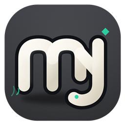

# 摸鱼小队 🐟

> 无广告 · 无账号 · 房码即开黑的轻量桌面语音应用

和朋友开黑用的语音聊天工具。打开、填房号、进房就能说话——没有广告、没有注册、没有推荐流。



## 特性

- **房码进房**：不用注册账号，报个房间号就能进
- **P2P 语音**：WebRTC 直连，语音流量不经过服务器
- **自由麦 / 按键说话**：按住空格说话，游戏时不影响队友
- **麦克风测试**：进房前先测电平和音量，带耳返试听
- **环境降噪**：自适应噪声门，只拦环境音不伤人声；另有防呼吸低切
- **每人独立音量 + 单独静音**
- **文字消息 + 表情 + 龙图贴图**（25 张内置熊猫头龙图，GIF 会动）
- **8 套主题**：深色 4 套 / 浅色 4 套，一键切换并记住
- **托盘常驻**：点关闭只最小化到托盘，语音不掉线
- **断线自动重连**：心跳保活 + 指数退避重连
- **零成本部署**：信令跑在 Cloudflare Workers 免费档

## 快速开始

```bash
npm install          # 安装依赖（Electron 下载需要国内镜像，见下方）
npm run server       # 终端 1：启动本地信令服务器（7788 端口）
npm start            # 终端 2：启动客户端
```

打开第二个实例（或让朋友连你的局域网 IP），填同一房间号即可互通。

### 国内网络安装 Electron

npm 新版会拦截 install 脚本，Electron 二进制需要手动补装：

```bash
ELECTRON_MIRROR=https://npmmirror.com/mirrors/electron/ node node_modules/electron/install.js
```

## 打包

```bash
npm run dist
```

产物在 `dist/摸鱼小队-Setup-<版本>.exe`（NSIS 一键安装包）。

## 部署信令服务器（可选）

线上默认节点已内置在客户端里（`wss://moyu.summersol.dpdns.org`），自建请改 `client.js` 里的 `DEFAULT_WSS`。

### Cloudflare Workers（免费，推荐）

```bash
cd worker
npm install
npx wrangler login
npx wrangler deploy
```

部署前在 `worker/wrangler.jsonc` 里把 `routes` 的域名改成你自己的。

启用 Cloudflare Realtime TURN（严格 NAT 兜底，免费档每月前 1000GB）：

```bash
npx wrangler secret put TURN_KEY_ID
npx wrangler secret put TURN_KEY_SECRET
```

### 本地 Node

```bash
npm run server
```

客户端在「服务器设置」里填 `ws://<你的IP>:7788`。

## 架构

```
客户端（Electron）
  ├─ WebRTC mesh：2~8 人语音 P2P 直连
  └─ WebSocket 信令：只交换连接信息，流量极小
        ↓
Cloudflare Worker（Durable Objects）
  ├─ /ws    房间信令
  └─ /ice   下发 STUN/TURN 打洞配置
```

语音本身走客户端之间直连（UDP 打洞），只有极端 NAT 环境才回落到 TURN 中继。

## 目录结构

```
├── main.js            Electron 主进程（窗口、托盘、麦克风权限、ICE 代取）
├── preload.js         渲染进程桥接（contextBridge）
├── index.html         界面结构
├── client.js          WebRTC mesh + 主题系统 + 贴图 + 聊天
├── style.css          设计系统（8 套主题走 CSS 变量）
├── stickers/          25 张内置龙图 + manifest
├── server/index.js    本地信令服务器
└── worker/            Cloudflare Worker（信令 + 静态页）
```

## 开发约定

- **调试语音一律用虚拟音轨**（`AudioContext` 合成音源），不要开物理麦克风——Windows 的麦克风是独占的，会抢掉用户正在进行的游戏语音
- 主题颜色一律走 CSS 变量（`--accent` 等），不要硬编码颜色
- 改客户端后记得同步 `worker/public/`（网页版用的是副本）

## License

MIT
